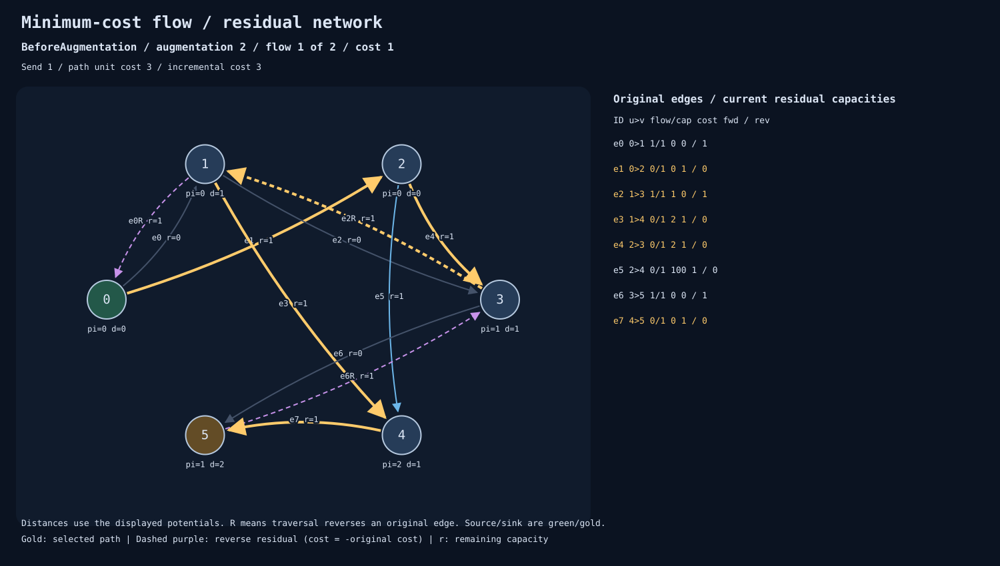

# mincost-flow-potentials

A small, auditable Rust implementation of minimum-cost flow using successive
shortest augmenting paths, vertex potentials, and Dijkstra. Includes independent
Bellman–Ford and exhaustive solvers, deterministic problem generators, numeric
certificates, and standalone SVG residual-network diagrams.

## Run

Install the current stable Rust toolchain, then run:

```sh
cargo test --locked
cargo run -- demo reassignment
cargo run -- demo transportation --seed 42
cargo run -- demo allocation --seed 42
cargo run -- solve examples/transport.json --out artifacts/transport
cargo run --release -- verify --seed 42 --cases 1000
```

`demo` and `solve` write `network.json`, `solution.json`, `trace.json`, and numbered
`frame-000.svg` files. Open the SVGs in a browser. A folder contains an initial
frame, before/after frames for each augmentation, and an unreachable-termination
frame when capacity is insufficient. Zero demand produces just the initial frame.
Reusing an output folder overwrites these outputs and removes surplus numbered
SVG frames; use separate output folders to retain previous runs.

Both commands validate the result's feasibility and residual optimality, compare
it with Bellman–Ford, and check traced/untraced agreement before exporting.
Errors produce a diagnostic on stderr and exit code 1. See `cargo run -- --help`.

## Why reverse edges matter

Two workers A/B must each receive one job X/Y. Assignment costs are:

| Worker | X | Y |
| --- | ---: | ---: |
| A | 1 | 2 |
| B | 2 | 100 |

The first path assigns A to X for cost 1. The second path traverses
`source → B → X → A → Y → sink`. The reverse edge X → A cancels the earlier
assignment for cost −1. This augmentation costs `2 − 1 + 2 = 3`; the final
assignments A → Y and B → X cost **4** in total.

In this diagram, vertices 0/5 are source/sink, 1/2 are A/B, and 3/4 are X/Y.
Gold highlights the second path. The dashed gold edge is the cancellation.



## Input and result contract

Input is a JSON network, as in [examples/transport.json](examples/transport.json):

```json
{
  "vertices": 2,
  "source": 0,
  "sink": 1,
  "requested_flow": 3,
  "edges": [{ "from": 0, "to": 1, "capacity": 5, "cost": 2 }]
}
```

- Vertex IDs are zero-based; networks contain 2–12 vertices with distinct terminals.
- Capacities, requested flow, and forward costs are nonnegative `u64` integers.
- Parallel and opposing edges have independent identities. Self-loops are rejected.
- Zero-capacity edges, zero costs, cycles, disconnected vertices, and zero demand
  are supported. Negative input costs and lower bounds are outside the MVP.
- `Satisfied` means exactly the requested flow was sent at minimum cost.
- `InsufficientCapacity` returns the minimum-cost maximum flow below the request.
- `edge_flows[i]` belongs to input edge `edges[i]`, even for parallel edges.
- Signed distances, potentials, and costs use checked `i128` arithmetic. Overflow
  returns `Error::Overflow`, never a wrapped answer.

Exact results can contain integers beyond JavaScript's safe-number range. Use an
integer-preserving JSON reader if consuming them outside Rust.

## Algorithm and correctness

Each original edge has a residual pair: a forward edge with remaining capacity
and cost `c`, and a reverse edge with capacity equal to current flow and cost `−c`.
Adjacent residual IDs pair with `id ^ 1`.

The main solver starts with zero flow and potentials `pi[v] = 0`. Nonnegative
forward costs make this initialization feasible without a Bellman–Ford pass.
Each complete Dijkstra run uses positive-capacity residual arcs with reduced cost

```text
reduced_cost(u,v) = cost(u,v) + pi[u] - pi[v]
```

Potentials telescope along a path, preserving shortest-path comparisons. For
every vertex reached by Dijkstra, update `pi[v] += distance[v]`. Augment by the
minimum of path residual capacity and remaining demand. Reverse arcs created
along the path then have zero reduced cost. Accumulate transportation cost using
original signed costs, not reduced costs.

The maintained invariant is nonnegative reduced costs on usable residual arcs
reachable from the source. Potentials for unreachable vertices remain unchanged;
the implementation does not claim global reduced-cost feasibility in disconnected
components. It checks every usable arc Dijkstra examines. Strict improvements and
heap ordering by `(distance, vertex)` make ties deterministic.

Feasible flow plus absence of a negative residual cycle certifies minimum cost
for the achieved flow. If demand remains unmet, absence of a residual source/sink
path additionally certifies maximum achievable flow. The independent certificate
checker tests both properties, including negative cycles in disconnected components.

For `A` augmentations, `V` vertices, and `E` original edges, the heap implementation
takes `O(A (V + E log(E+1)))` time and `O(V+E)` working space. Integral capacities
give `A ≤ requested_flow`, so this bound is pseudopolynomial. Stored traces add
`O(A(V+E))` space. Bellman–Ford takes `O(A V E)` time.

Background: [CP Algorithms: minimum-cost flow](https://cp-algorithms.com/graph/min_cost_flow.html).

## Independent verification

- `bellman_ford::solve` rebuilds residual transitions from original-edge flows.
  Its shortest-path and augmentation logic are separate from the main solver.
- `exhaustive::solve` enumerates integer assignments directly on original edges,
  rejects conservation violations, then maximizes flow up to demand and minimizes
  cost. It uses neither solver's residual graph.
- `verification::check` recomputes capacities, conservation, and cost, then checks
  residual negative cycles and, for partial answers, residual reachability.

Enumeration requires `product(capacity[e] + 1)` assignments, with `O(V+E)` work
per assignment. The budget is checked before searching. `verify` reports checked
and skipped counts separately; skipped cases still receive Bellman–Ford and
certificate checks. Its default budget is 100,000 assignments. Failures print the
seed, case index, and input network for reproduction.

Tests cover 6,561 exhaustively generated networks with three-way comparisons,
seeded general networks, transportation/allocation families, reverse-edge
reassignment, infeasibility, zero demand, parallel/opposing edges, zero-cost
cycles, disconnected components, overflow, trace replay, and CLI output/errors.
Different optimal edge assignments are allowed when comparing solvers.

## Traces and metrics

`potentials::solve_with_trace` records edge flows, vertex potentials, Dijkstra
distances (`null` means unreached), selected residual IDs, augmentation amount,
path unit cost, incremental cost, and cumulative flow/cost. Residual ID `2*i`
traverses original edge `i`; `2*i+1` reverses it. Before frames use search-time
potentials. After frames show updated potentials alongside distances from the
preceding search and highlight the path just used, even if now saturated.

SVGs use fixed vertex positions, curved forward/reverse arcs, path highlights,
remaining-capacity labels, and a ledger with exact flow, capacity, original cost,
and both residual capacities. Dense networks can have overlapping diagram labels;
the numeric ledger and JSON retain exact values.

`solution.json` includes:

| Metric | Definition |
| --- | --- |
| `flow`, `cost` | Achieved total flow and original-cost objective |
| `augmentations` | Successful positive-flow augmentations |
| `heap_pushes`, `heap_pops` | Heap operations, including source insertions |
| `stale_pops` | Popped entries superseded by a shorter distance |
| `relaxations` | Strict distance improvements |
| `residual_edges_examined` | Adjacency entries scanned, including zero-capacity arcs |
| `potential_update_rounds` | Successful shortest-path rounds updating potentials |
| `vertices_updated` | Reached vertices processed across update rounds, including zero changes |
| `runtime_ns` | Elapsed solver time, including residual initialization |

The CLI measures a separate untraced solve: rendering, snapshot creation,
serialization, input parsing, and independent verification are excluded. Use
`cargo run --release` for timing; tiny graphs make individual timings noisy.
Runtime varies between runs. Seeded inputs, tie-breaking, counters, and trace data
are deterministic. Bellman–Ford reuses the metrics shape; heap/potential counters
are zero and its edge counter counts available transitions scanned per pass.

## Library

```rust
use mincost_flow_potentials::{Edge, Network, solve, verification};

let network = Network {
    vertices: 2, source: 0, sink: 1, requested_flow: 3,
    edges: vec![Edge { from: 0, to: 1, capacity: 5, cost: 2 }],
};
let result = solve(&network).unwrap();
verification::check(&network, &result).unwrap();
assert_eq!((result.flow, result.cost), (3, 6));
```

## Development

```sh
cargo fmt --check
cargo clippy --locked --all-targets -- -D warnings
cargo test --locked
```

The implementation is intentionally limited to small educational
networks; it does not implement cost scaling, negative forward costs, flow lower
bounds, or a production optimization-service API.

Licensed under MIT.
